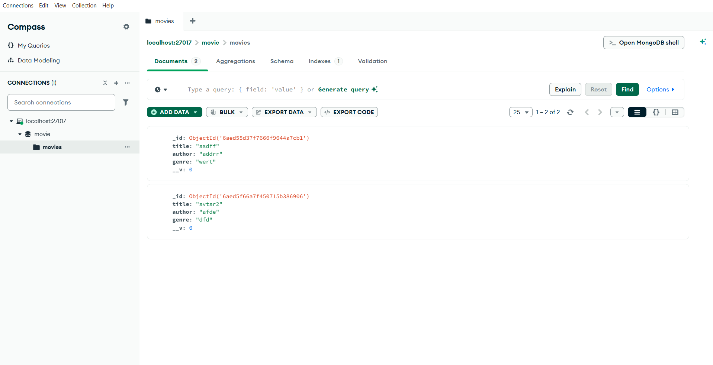
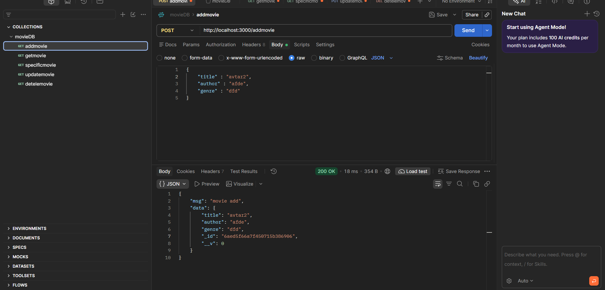
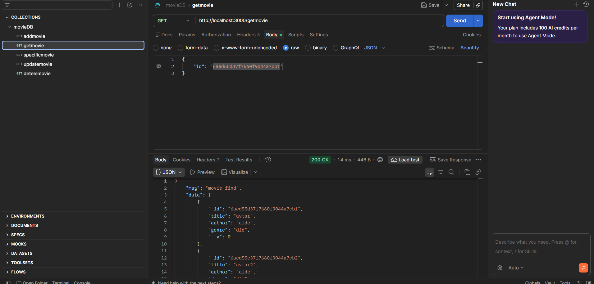
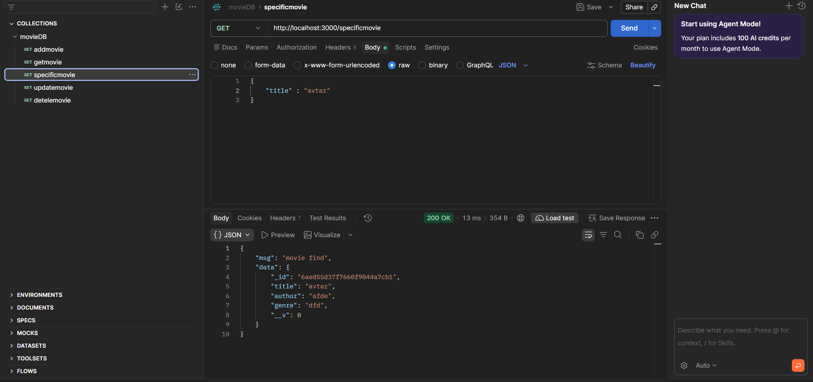
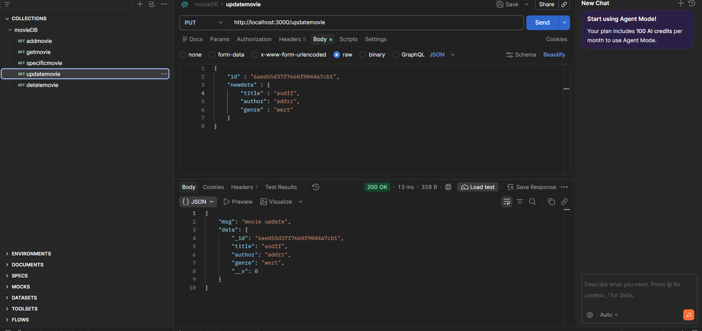
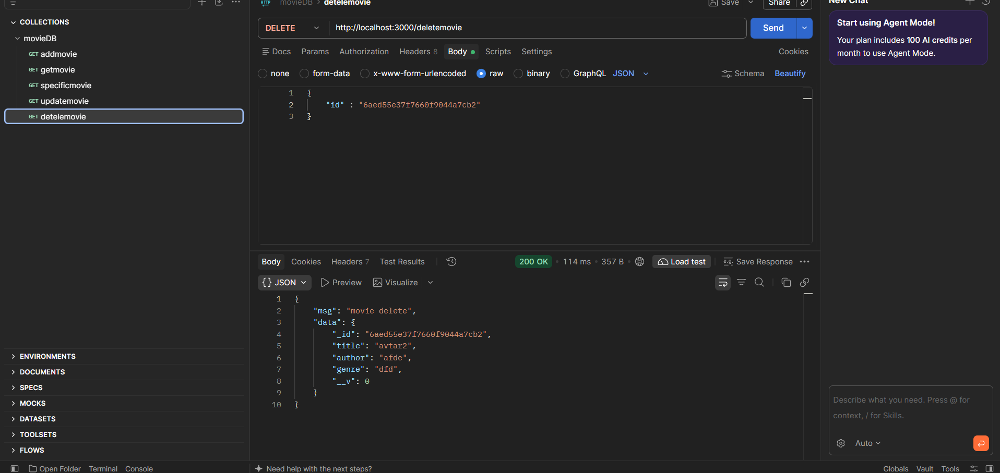

## 🎬 Movie Management API

## 📌 About Project

Movie Management API is a RESTful backend application developed using Node.js, Express.js, MongoDB, and Mongoose.

This project allows users to manage movie records using CRUD operations (Create, Read, Update, Delete).

## 🚀 Features
- ➕ Add New Movie

- 📋 Get All Movies

- 🔍 Find Specific Movie

- ✏️ Update Movie Details

- 🗑️ Delete Movie

- 🗄️ MongoDB Database Connectivity

## 🛠️ Technologies Used
- 🟢 Node.js

- 🚂 Express.js

- 🍃 MongoDB

- 📦 Mongoose

- 💻 JavaScript

## 📝 API Request Examples

- ➕ Add Movie
    - POST /addmovie

- 🔍 Get Specific Movie
    -  GET /specificmovie

- ✏️ Update Movie
   - PUT /updatemovie

- 🗑️ Delete Movie
   - DELETE /deletemovie

## 🖼️ ScreenShot

## 🎥 Video

